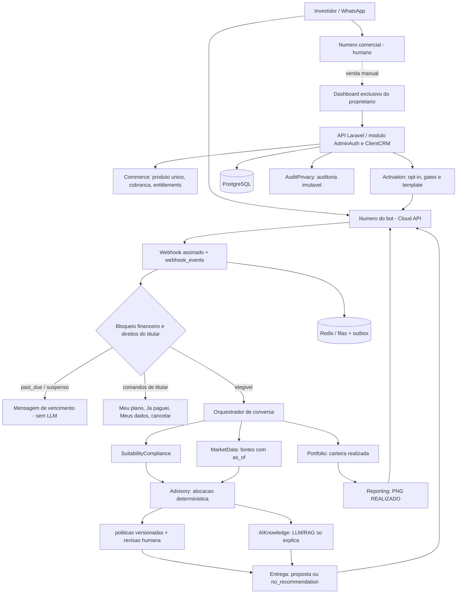

# Visão geral da arquitetura

Este documento descreve o desenho adotado para o MVP v1.2. As decisões estão em [`docs/adr/0001`](../adr/0001-arquitetura-monolito-modular.md) e [`docs/adr/0002`](../adr/0002-piloto-ficticio-e-producao.md).

## Fluxo de ponta a ponta

O número comercial **nunca** automatiza mensagens e o investidor **nunca** recebe login, portal ou miniapp (RB-021, RB-027).

## Fronteiras de módulo

| Módulo | Entrada | Saída / contrato |
|---|---|---|
| `AdminAuth` | credencial única + MFA | sessão administrativa, eventos de sessão |
| `ClientCRM` | cadastro manual do proprietário | `investor` com origem do dado e status do ciclo de vida |
| `Commerce` | venda, plano, webhook do gateway | `subscription`, `payment_record`, `entitlement` |
| `Activation` | proprietário solicita ativação | `activation_request` idempotente, template pelo bot |
| `WhatsAppGateway` | webhook assinado, eventos de entrega | mensagem normalizada, `webhook_events`, deduplicação |
| `SuitabilityCompliance` | respostas do bot | perfil versionado, bloqueios e casos de revisão |
| `Portfolio` | `TransactionConfirmed` | posições recalculadas, fatos de carteira |
| `MarketData` | fontes oficiais/licenciadas | cotação com `as_of`, `source_id`, `quality_status` |
| `Advisory` | intenção, perfil, carteira, mercado | proposta determinística ou `no_recommendation` |
| `AIKnowledge` | proposta validada, documentos permitidos | explicação fundamentada, sem novos fatos |
| `Reporting` | carteira realizada ou proposta | PNG com marca d'água e data-base |
| `AuditPrivacy` | eventos de domínio | `audit_events`, `privacy_requests`, trilha íntegra |

## Contrato do webhook do bot

A ordem é parte do desenho de segurança e deve ser testada como tal:

| Etapa | Ação | Falha / efeito |
|---|---|---|
| 1 | validar assinatura e gravar `webhook_events` por `external_id` + `payload_hash` | duplicata é descartada sem resposta adicional |
| 2 | vincular investidor e conversa | remetente desconhecido recebe orientação para o número comercial |
| 3 | consultar `entitlement` no banco/gateway | indisponibilidade do gateway => "em verificação", nunca "inadimplente" |
| 4 | classificar comandos permitidos no bloqueio | direitos do titular e suporte humano continuam disponíveis |
| 5 | se bloqueado, enviar mensagem-padrão e parar | nenhum token de LLM, recomendação ou PNG pago é produzido (A13) |
| 6 | processar elegível com `trace_id` correlacionado | resposta rápida; trabalho pesado vai para fila |

Links de pagamento exibidos ao cliente vêm somente do gateway e são validados; o LLM nunca os gera (§FL-05).

## Consistência e idempotência

- `outbox` publica eventos após o commit da transação; consumidores são idempotentes por chave natural.
- `webhook_events`, `portfolio_transactions.idempotency_key` e `activation_requests.idempotency_key` impedem duplicação em reprocessamento (RB-016, A6, A15).
- Correções de operações usam eventos compensatórios (`reverses_id`); o histórico permanece íntegro (RB-014).
- Cada recomendação registra snapshot de contexto, fontes, regras, modelo, versão e revisão (RB-018); `market_snapshot` é datado.

## Fronteira IA

O LLM recebe apenas uma proposta já calculada e documentos autorizados. Não decide alocação, não consulta preço ao vivo, não cria ticker, não altera carteira e não executa ordens (RB-010, RB-017). Documentos de RAG são tratados como dados não confiáveis: instruções neles nunca alteram regras de suitability ou compliance (teste §16.6).

## Ligações

- `docs/adr/0001-arquitetura-monolito-modular.md`
- `docs/adr/0002-piloto-ficticio-e-producao.md`
- `docs/architecture/ambientes.md`
- `docs/compliance/mapa-gates.md`
- `docs/plano-execucao-mvp.md`
