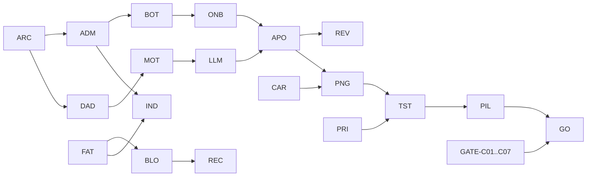

# Plano de execução do MVP AporteAI

Versão: 2026-11-17. Fonte: PRD AporteAI v1.2 §14–§16 e cards do projeto AporteAI no Gartrol.

## Estado conferido

- 26 cards no projeto; antes deste trabalho todos estavam `open` — nenhum em "em execução" e nenhum em "feito".
- `ARC` está `in_progress` nesta sessão; é o card-raiz, sem dependências, e destrava `ADM` e `DAD`.
- Os gates C01–C07 são cards separados e permanecem `open`; a liberação comercial não depende apenas de código.
- O repositório local está em `722b07b` (`Initial commit`). Um checkpoint antigo citava PR #1/`649f5d8` em `/var/www/html/Estudos/AporteAI`, caminho inexistente neste ambiente e sem remote acessível; a divergência foi registrada no checkpoint do card.

## Sprints e cards

| Sprint | Foco | Cards Gartrol | Critério de saída (PRD §14) |
|---|---|---|---|
| S0 | fundação e governança | `ARC` + `GATE-C01`…`GATE-C07` | escopo autorizado para construção; **não** go-live regulado |
| S1 | dashboard, conta única, banco, CI/CD | `ADM` | login MFA, cadastro manual e auditoria |
| S2 | número do bot, webhooks, filas, ativação | `BOT` | proprietário ativa cliente elegível sem duplicação |
| S3 | produto, cobrança, suitability, bloqueio pré-LLM | `FAT`, `ONB`, `BLO`, `REC` | onboarding 100% WhatsApp; vencimento interceptado antes da IA |
| S4 | metas, catálogo e carteira | `CAR` | posições recalculadas a partir de eventos |
| S5 | dados de mercado | `DAD` | proveniência, staleness e erros cobertos |
| S6 | motor determinístico | `MOT` | 100% de reconciliação em centavos e casos impeditivos |
| S7 | RAG e gateway LLM | `LLM` | avaliações e bloqueio de alucinações |
| S8 | proposta, revisão, auditoria e aporte | `APO`, `REV` | percurso completo sem execução de ordens |
| S9 | PNG, painel e métricas | `PNG`, `IND` | gráficos reais/projetados distintos; sem portal do cliente |
| S10 | cobrança, segurança, privacidade e stress | `TST`, `PRI` | testes P0/P1 e checklist de produção |
| S11 | piloto controlado e decisão final | `PIL`, `GO` | relatório de prontidão, runbooks e rollback |

`GATE-C01…C07` são paralelos e externos à engenharia; `GO` depende da evidência deles. Cards das fases posteriores não devem ser reivindicados antes de suas dependências serem concluídas.

## Dependências críticas

A ordem acima espelha as relações `depends_on` registradas no grafo do Gartrol; a aplicação das dependências é verificada no claim.

## Entrega desta fase (S0/ARC)

Artefatos produzidos neste card:

- `docs/adr/0001-arquitetura-monolito-modular.md`
- `docs/adr/0002-piloto-ficticio-e-producao.md`
- `docs/architecture/visao-geral.md`
- `docs/architecture/ambientes.md`
- `docs/compliance/mapa-gates.md`
- `docs/product/politica-produto.md`
- este plano

Fora de escopo do ARC: implementação de código, credenciais reais, contratos assinados e decisão de liberação comercial.

## Definição de pronto por card

1. Critérios de aceite do PRD aplicáveis e testes correspondentes executados.
2. Evidência anexada à entrega no Gartrol (comando, teste, artefato ou nota verificável).
3. Proveniência Git informada: branch, commits e, quando houver, pull request.
4. Auditoria e trilha de decisão registradas quando a mudança tocar regras críticas.
5. Card entregue como `done` pelo agente; validação/rejeição é ato humano.

## Checagens

- Durante a iteração: validação de documentos e links internos, revisão de regras críticas contra RB-001…RB-033 e A1…A16.
- Antes da integração: gate completo do repositório, com revisão humana para mudanças de alto risco.
- Antes do go-live: checklist de produção, restore testado, fontes licenciadas e gates documentados.

## Adendo 18/11/2026

O "Estado conferido" e o commit citado no topo são registros históricos da sessão S0.
A base técnica auditada em 18/11/2026, com CI e correções REG, está descrita em
[base executável](execution-baseline-2026-11-18.md). Nenhuma data deste plano foi
reescrita; a ordem de dependências e a ressalva sobre GO permanecem válidas.
